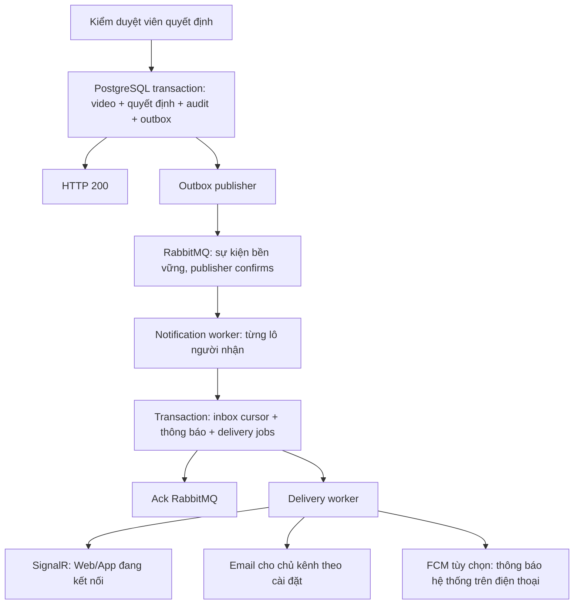

# Duyệt video và thông báo qua RabbitMQ

Khi kiểm duyệt viên duyệt video, API kiểm tra quyền, claim và trạng thái kênh/video; lưu `Video.Status=published`, `ModerationStatus=approved`, quyết định, audit và một sự kiện outbox trong cùng transaction PostgreSQL. API trả HTTP 200 sau commit, không truy vấn danh sách người đăng ký và không đợi RabbitMQ, SignalR, email hay FCM.



Sự kiện `video.approved.v1` bao gồm duyệt thông thường, giới hạn tuổi và hạn chế đề xuất. `video.moderated.v1` dùng cho từ chối/chuyển cấp. Các quy tắc gậy phạt, khóa kênh, phân quyền, claim và hợp đồng HTTP hiện có được giữ nguyên. Chỉ lần xuất bản công khai đầu tiên gửi thông báo video mới; người đăng ký sau thời điểm quyết định không nhận thông báo cũ. Worker kiểm tra lại video/kênh còn công khai và hợp lệ trước mỗi lô.

## Đảm bảo giao nhận

- Outbox chỉ được đánh dấu published sau khi RabbitMQ xác nhận và không trả lại message vì không route được. Mất broker thì outbox vẫn chờ và tự thử lại, backoff tối đa 5 phút.
- Queue quorum, exchange và message đều bền vững. Một node có khả năng khôi phục sau restart; triển khai hiện tại chưa có HA đa máy.
- Consumer dùng manual ack, prefetch 1; nhận lại message tiếp tục từ cursor inbox. Thông báo và delivery jobs được tạo cùng transaction, khóa inbox theo event ID và có ràng buộc duy nhất `(event_id,user_id,type)`.
- Fanout xử lý tối đa 250 subscriptions/lô (cấu hình `RabbitMq__FanoutBatchSize`, giới hạn 1–1000), dùng keyset theo subscription ID và index theo kênh. Không tải toàn bộ người đăng ký vào RAM.
- Lỗi consumer chuyển qua queue `.retry` sau 30 giây; mặc định 10 lần rồi `.dead`. JSON/hợp đồng không hợp lệ vào `.dead` ngay. Dead-letter transfer cũng dùng chế độ at-least-once.
- Bốn delivery workers dùng `FOR UPDATE SKIP LOCKED`. SignalR/email/FCM có trạng thái riêng; lỗi email không gửi lại SignalR đã hoàn tất. Thiết bị hết phiên/đã logout không được nhận push; token FCM `UNREGISTERED` bị gỡ.
- Tác động bên ngoài là **at-least-once**: process chết sau khi nhà cung cấp nhận nhưng trước commit có thể gửi lại email/push. Không cam kết exactly-once cho nhà cung cấp bên ngoài. Inbox ID ổn định để Web/Mobile gộp SignalR nhận lại, Mobile gộp SignalR/FCM và dùng Android tag ổn định.
- Cài đặt thông báo mới, kiểm duyệt, in-app và email được kiểm tra trong worker. Thành viên bị xóa/khóa không nhận delivery mới.

## Local Windows / WSL

Máy không cần Docker Desktop. Ubuntu WSL cài RabbitMQ/Erlang từ APT; broker được bind vào `127.0.0.1`, dữ liệu ở `/var/lib/rabbitmq` của distro.

```powershell
./scripts/setup-local.ps1  # áp dụng migration vào DB Development đã cấu hình
./scripts/setup-rabbitmq.ps1
./scripts/run-local.ps1 -Component api
```

Setup tạo `.env.messaging.local` bị Git ignore, mật khẩu ngẫu nhiên và ACL chỉ cho tài khoản Windows hiện tại. Script chạy API đọc thêm file này và khởi động broker nếu WSL vừa restart. Management UI: `http://127.0.0.1:15672`; lấy thông tin đăng nhập từ file local, không commit mật khẩu.

Nếu dùng Docker Compose, đặt `POSTGRES_PASSWORD` và `RABBITMQ_PASSWORD` trong env local rồi chạy `docker compose --env-file .env.local --profile api up -d`. Hai phương án cùng dùng cổng 5672/15672 nên chỉ chạy một broker trên các cổng đó.

Kiểm thử cần PostgreSQL **cô lập** và broker local: đặt `TEST_DATABASE_CONNECTION`, `TEST_RABBITMQ_PASSWORD`, tùy chọn `TEST_RABBITMQ_HOST` (mặc định 127.0.0.1). `scripts/test.ps1` đọc thông tin broker từ `.env.messaging.local`. Các test tạo/xóa queue với tên ngẫu nhiên `dalitu.test.*`; không dùng queue ứng dụng. CI có service PostgreSQL và RabbitMQ riêng.

## AWS EC2

```bash
bash scripts/deploy/install-ec2-rabbitmq.sh /home/ubuntu/apps/HuTube
```

Installer chỉ cài/khởi động broker, không build/migrate/restart API. Nó sao lưu `.env.ec2-api` trong `~/.config/dalitu/rabbitmq/`, thêm cấu hình `RabbitMq__*`, tạo `.env.rabbitmq` riêng chỉ chứa thông tin broker (mode 600) và cấu hình Compose độc lập. Broker ở container `dalitu-rabbitmq`, hostname ổn định, cùng network với API; dữ liệu ở volume `hutube-ec2_rabbitmq-data`. Giới hạn container 384 MB, watermark 192 MiB, ngưỡng trống đĩa 1 GB. Cổng 5672/15672 chỉ publish trên localhost; không cần mở Security Group hay Caddy.

Sau khi code được cho phép merge/push và qua CI, quy trình deploy hiện có chạy migration `20261025100000_AddModerationNotificationOutbox`, bảo đảm RabbitMQ healthy rồi kích hoạt API. Bản code cục bộ không được tự triển khai lên production. `.env.ec2-api` cấp secret cho API; `.env.rabbitmq` cấp secret cho broker, không phụ thuộc Compose interpolation của `.env`.

Để truy cập management từ PC, dùng SSH tunnel cổng 15672. Không mở management ra Internet. Dùng `rabbitmq-diagnostics check_local_alarms`, `docker stats --no-stream` và management để theo dõi queue, retry, dead letters và dung lượng.

## FCM tùy chọn

RabbitMQ + outbox + SignalR hoạt động độc lập với Firebase. `Fcm__Enabled` mặc định false trong template; các APK thiếu cấu hình Firebase không khởi tạo FCM. Khi tắt FCM, không tích lũy push cũ để gửi bù sau này; thông báo trong hộp thư vẫn giữ theo cài đặt.

Project đã cấu hình là `dalitu-c9178`, Android package `com.hutube.user_app`, Firebase app ID `1:268414011248:android:c8e6548651bab7a5fa71b5`. `mobile/user-app/assets/firebase.public.json` chỉ chứa bốn mã cấu hình công khai; không chứa service account. Android Gradle tạo resources tương ứng để native Firebase khởi tạo được khi app đã đóng, trước khi Dart chạy. Các build defines không rỗng ghi đè cấu hình mặc định ở cả native và Dart. Cấu hình này không thay đổi OAuth client đăng nhập Google hiện có.

Khóa server được lưu ngoài repository: local `C:/Users/duytn/.config/dalitu/firebase/service-account.json` (ACL tài khoản Windows hiện tại), AWS `/home/ubuntu/.config/dalitu/firebase/service-account.json` (directory 700, file 400, owner theo UID của API). Env riêng local và AWS đã bật FCM cho lần chạy/deploy tiếp theo. Compose mount directory read-only vào `/run/secrets/firebase`; khóa không được đóng gói vào APK hay image. API production chưa được restart/deploy để nạp cấu hình mới.

Muốn bật push hệ thống:

1. Backend: đặt `Fcm__Enabled=true`, `Fcm__ProjectId`, `Fcm__CredentialsPath` trỏ đến **service account** có quyền gửi FCM. Trên EC2 có thể chạy `bash scripts/deploy/install-ec2-fcm.sh /path/to/private-service-account.json /home/ubuntu/apps/HuTube`: installer sao lưu env, cấp quyền file theo UID API và cập nhật env, không restart API. Client dùng HTTP v1, chỉ nạp credential loại service account, dùng chung cache OAuth token giữa các delivery.
2. Android: mặc định dùng public asset ở trên; có thể ghi đè bằng `FIREBASE_API_KEY`, `FIREBASE_APP_ID`, `FIREBASE_PROJECT_ID`, `FIREBASE_MESSAGING_SENDER_ID`. GitHub environment `mobile` hỗ trợ các biến cùng tên; script chạy local cũng nhận chúng. SDK 16.x được chọn cho hợp đồng registration token / HTTP v1 hiện tại.
3. iOS không dùng cấu hình Android mặc định: cần bốn defines của app iOS, thêm `FIREBASE_IOS_BUNDLE_ID`, APNs cấu hình trong Firebase, capability Push Notifications và provisioning tương ứng.
4. App chỉ đăng ký thiết bị khi đã đăng nhập và được cấp quyền thông báo; token được gắn với session qua `PUT /api/v1/notifications/devices`, gỡ qua `DELETE` có body token. App đăng ký lại khi session ID đổi sau refresh; backend kiểm tra session còn hiệu lực và không nhận user ID từ request body.

Đã kiểm tra xác thực HTTP v1 với `validate_only=true`, token giả: Google trả lỗi token không hợp lệ thay vì lỗi quyền/xác thực, không gửi thông báo thật. Kiểm tra push tới thiết bị thật cần APK đã đăng nhập/cấp quyền và API mới; bước này chưa thực hiện vì chưa được triển khai code develop lên production. Android force-stop trong Settings cần mở app lại theo [tài liệu Firebase](https://firebase.google.com/docs/cloud-messaging/flutter/receive-messages).

## Theo dõi và khôi phục

Các bảng: `moderation_outbox_events`, `notification_inbox_events`, `notification_deliveries`, `push_devices`. Outbox chưa published / delivery chưa completed cần được theo dõi độ tuổi, số lần thử và `last_error`. Lỗi chỉ lưu loại lỗi, không lưu token hay mật khẩu.

```sql
SELECT count(*), min(occurred_at) FROM moderation_outbox_events WHERE published_at IS NULL;
SELECT count(*), min(available_at) FROM notification_deliveries WHERE completed_at IS NULL;
```

Queue chính `dalitu.video.notifications`; retry và dead-letter có hậu tố `.retry` và `.dead`. Sau khi sửa nguyên nhân lỗi, có thể đưa message từ DLQ về exchange `dalitu.video.events` với routing key `video.retry.v1`, giữ nguyên event ID. Đừng purge queue để xử lý lỗi: inbox chống trùng và tiếp tục tiến độ đã lưu.

Trước khi rollback migration: dừng publisher/consumer, drain cả queue/retry/dead và các delivery đang chờ. Migration Down từ chối khi SQL còn công việc chưa hoàn tất; nó không thể kiểm tra broker nên cần kiểm tra queue riêng. Sao lưu DB trước rollback. Nếu chỉ rollback phiên bản API, giữ các bảng để sự kiện không bị mất.

Không tự xóa inbox/outbox đã hoàn thành ngay: giữ cả hai để chống replay. Nếu cần retention, chỉ xóa theo chính sách đồng bộ sau khi chắc chắn không còn bản message trong broker/backup; chưa tự thêm chính sách purge.

Tham khảo chính thức: [RabbitMQ .NET client](https://www.rabbitmq.com/client-libraries/dotnet-api-guide), [publisher confirms và acknowledgements](https://www.rabbitmq.com/docs/confirms), [quorum dead-lettering](https://www.rabbitmq.com/docs/quorum-queues#dead-lettering), [FCM Flutter](https://firebase.google.com/docs/cloud-messaging/flutter/receive-messages).
